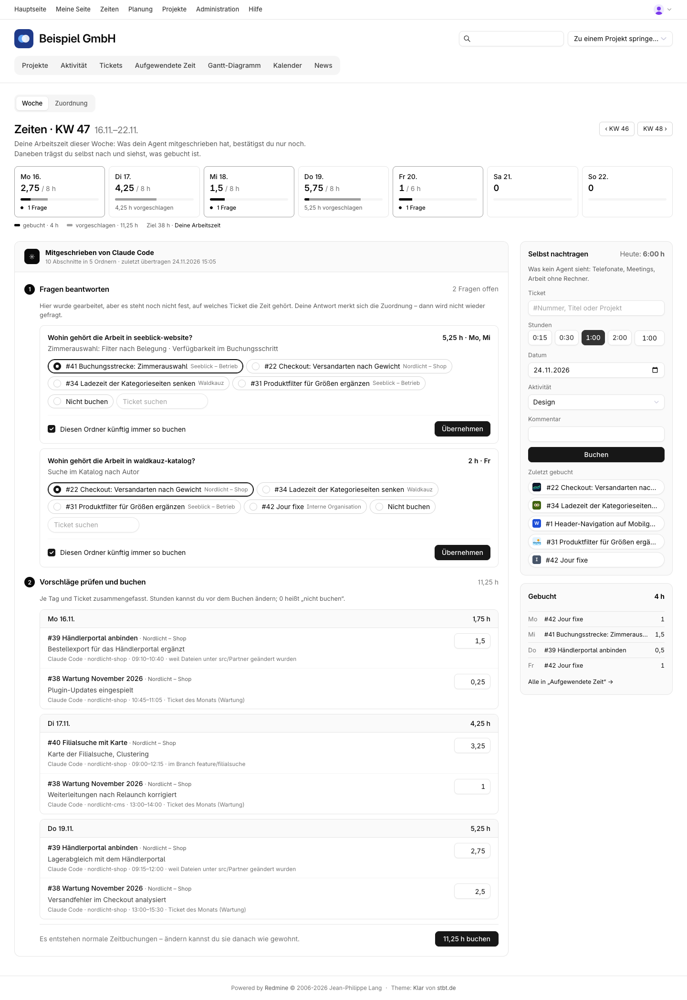
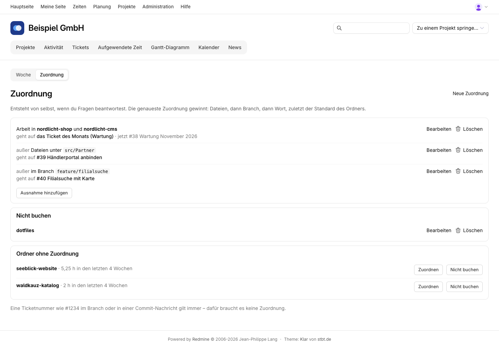
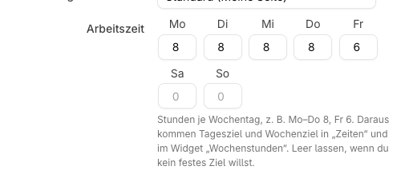
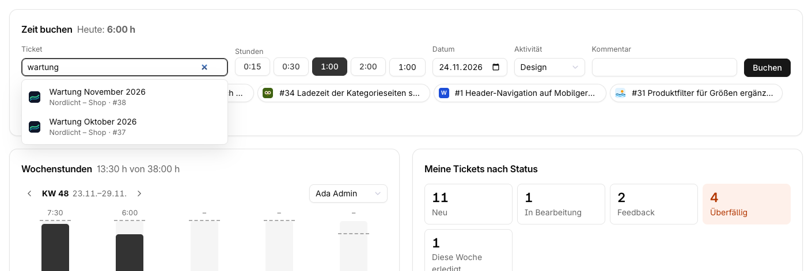
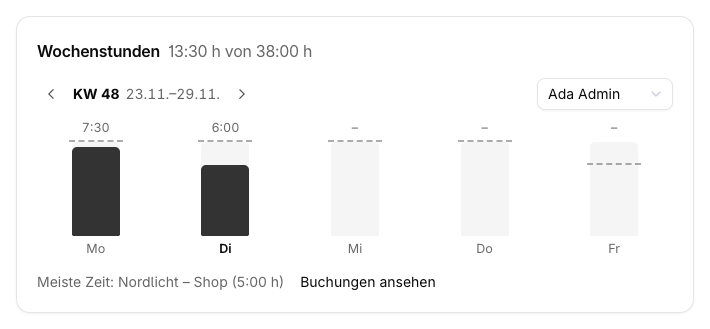
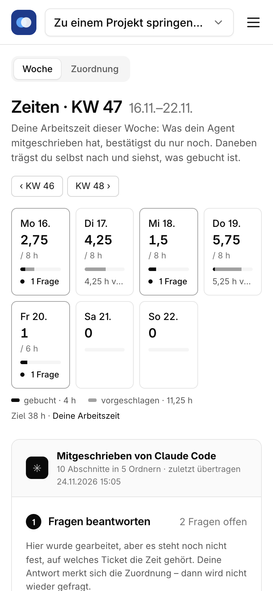

# Time Autopilot – time tracking in Redmine, with proposals from recorded work

Time Autopilot turns recorded work into Redmine time entries. A sender – for example a
local script that analyses your coding sessions – uploads work segments as drafts: day,
hours, folder, branch, changed files, issue numbers and a short summary. You decide once
where the work of a folder belongs; from then on the week is ready to book with one
click. Nothing is booked without you.

- **Week** – a strip with every day, hours against the daily target and what is still
  open. Below it *Quick questions* for folders without a rule and *Ready to book*: one
  line per day and issue with the summary as comment and one sentence on why it landed
  there. Hours can be changed before booking; *0* means *don't book*.
- **Questions instead of setup** – *Where does the work in `campaign-monitor` belong?*
  with suggested issues (the sender's guess, then the issues you logged most time on
  recently), *Don't book* or any issue number. *Always book this folder like this* turns
  the answer into a rule, which applies immediately to every open draft.
- **Rules as sentences** – *Work in `shop` and `shop-cms` goes to the issue of the month
  (Maintenance)*, *except files under `www/src/Jobs` → #4630*. The most specific rule
  wins: an issue number in the work itself (`#123` in the branch or a commit message),
  then files, branch, word, and finally the folder default.
- **Issue of the month** – recurring budgets like monthly maintenance: the open issue
  with the word in its subject that runs in the given month (start to due date, otherwise
  the month in the subject, *November 2026*). If it is missing it is created when booking,
  as a copy of the previous month's issue (subject with the new month, assignee,
  estimate, parent; runs the whole month), optionally closing the previous one.
- **Regular time entries** – booking creates normal Redmine time entries with
  Redmine's permissions (*Log spent time*, *Add issues* for monthly issues). Anything that
  fails stays a draft and is reported.
- **Your own entries next to it** – the right column of the page logs time by hand (calls,
  meetings, anything no agent sees) and lists what is logged this week.
- **Working hours per weekday** under *My account* (administrators: in the user's
  settings), e.g. Monday–Thursday 8 h, Friday 6 h. They set the daily targets on the page
  and in the *Weekly hours* block.
- **Blocks for My page** – *Log time* (find an issue, pick a duration, log without leaving
  the page, undo) and *Weekly hours* (logged per day against the working hours, step
  through weeks, pick a colleague; shows what is still waiting as a proposal). Until
  Dashboard Blocks 1.3 these were part of
  [Dashboard Blocks](https://github.com/stbt-de/redmine-dashboard-blocks); the block names
  are unchanged, so existing arrangements and settings stay.
- **Spent time** gets a link to the page, with the hours waiting as proposals.

The page is called *Time* (*Zeiten* in German) and sits in the top menu for everyone who
may log time in at least one project. It has two columns: on the left what an agent
recorded – *Answer questions*, then *Check and book proposals* – headed by the sender's
name and when it last sent data; on the right *Log it yourself* and *Logged*. Rules and
drafts are per person.

## Screenshots

*Shown with the [Klar theme](https://github.com/stbt-de/redmine-klar-theme) and example data.*



| Rules | Working hours (My account) |
| --- | --- |
|  |  |

| Log time (My page) | Weekly hours (My page) | Mobile |
| --- | --- | --- |
|  |  |  |

## Sending drafts

`POST /time_autopilot/drafts.json` with your API key (REST API enabled under
*Administration → Settings → API*):

```json
{
  "drafts": [
    {
      "source_key": "2026-11-16/9f3c…/10:05",
      "spent_on": "2026-11-16",
      "started_at": "10:05",
      "ended_at": "10:50",
      "hours": 0.75,
      "folder": "shop",
      "branch": "main",
      "paths": ["www/src/Jobs/Controller/Webhook.php"],
      "issue_refs": ["#4630"],
      "summary": "Webhook test for incoming applications added",
      "guess_issue_id": 4630,
      "source": "Claude Code"
    }
  ],
  "replace_from": "2026-11-16",
  "replace_to": "2026-11-22"
}
```

- `source_key` identifies a segment at the sender. Uploading it again replaces an open
  draft; booked and skipped drafts are kept.
- With `replace_from`/`replace_to`, open drafts in that range that were not sent again
  are removed – a sender can simply re-upload a whole week.
- `source` names the sender (e.g. *Claude Code*); the page shows it above the proposals.
- Only hours, folder, branch, file paths, issue numbers and the summary are stored – no
  prompts or file contents.

## Working with agents (REST API and MCP)

Everything the page does is also available to agents, with the person's API key and
Redmine's permissions:

| | |
| --- | --- |
| `GET /time_autopilot.json?week=YYYY-MM-DD` | the week: questions, proposals with `key`, totals |
| `POST /time_autopilot/answer.json?week=…` | `{"folder": "shop", "issue_id": 45, "remember": true}` or `{"folder": "private", "skip": true}` |
| `POST /time_autopilot/book.json?week=…` | `{"hours": {"<key>": 1.5}, "keys": ["<key>"]}` – both optional |
| `POST /time_autopilot/drafts.json` | upload drafts (see above) |
| `GET /time_autopilot/rules.json` | rules as sentences, folders without a rule |
| `GET /time_autopilot/issues.json?term=…` | open issues by number or subject |

`mcp/` contains an MCP server wrapping these endpoints (tools `time_week`, `time_answer`,
`time_book`, `time_upload`, `time_rules`, `time_search_issues`), so an agent can show the
week in a chat, take the answers and book after an explicit okay:

```bash
cd mcp && npm install
claude mcp add redmine-time-autopilot -s user \
  -e REDMINE_URL=https://redmine.example.com -e REDMINE_API_KEY=<your key> \
  -- node /path/to/redmine_time_autopilot/mcp/server.mjs
```

`REDMINE_URL=… REDMINE_API_KEY=… node mcp/smoke.mjs` checks the connection (read only).

## Installation

1. Copy the plugin to `plugins/redmine_time_autopilot`.
2. `bundle exec rake redmine:plugins:migrate NAME=redmine_time_autopilot RAILS_ENV=production`
3. Restart Redmine.

Requires Redmine 6.0 or later. Coming from Dashboard Blocks 1.3: install Time Autopilot,
then update Dashboard Blocks to 2.0 – the time blocks and working hours carry over.
Uninstall with
`bundle exec rake redmine:plugins:migrate NAME=redmine_time_autopilot VERSION=0 RAILS_ENV=production`.

### Tested with

| Redmine | Checked |
| --- | --- |
| 7.0.3 | integration tests; in the browser with the theme Klar (desktop, mobile) |
| 6.0 | integration tests |

The interface is available in English and German.

## Development

`dev/run-tests.sh` runs the tests against a fresh Redmine 7.0 in Docker,
`REDMINE_VERSION=6.0 dev/run-tests.sh` against 6.0.

## Built with AI assistance

This plugin was developed together with an AI coding assistant. Most of the code was
written by the assistant; the direction, design decisions and review came from
[stbt.de](https://stbt.de/). Every feature is covered by integration tests and was
checked in a running Redmine.

## License

MIT
